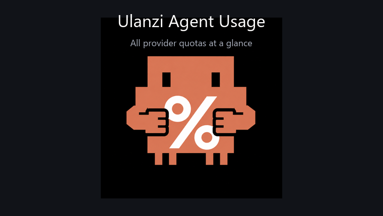
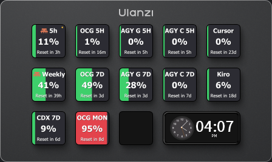

# Ulanzi Agent Usage

[](https://nodejs.org/)
[](https://github.com/UlanziTechnology/UlanziDeckPlugin-SDK)
[](.github/workflows/ci.yml)
[](LICENSE)

[English](README.md) · [繁體中文](README.zh-TW.md) · 日本語 · [한국어](README.ko.md)

Claude Code、Codex、Cursor、GitHub Copilot、Kiro、Antigravity、Grok、OpenCode Go など、AI コーディングエージェントの使用量を Ulanzi Deck に表示します。



同梱のプレビューは、plugin が使用する使用量アイコンの状態を順番に表示します。特定の D200/D200H 実機を録画したものではありません。

## Ulanzi D200H 実機プレビュー



これはメンテナーが共有する実際の Ulanzi D200H 画面です。表示される provider、
割合、リセット時刻はアカウントによって異なります。

> 本プロジェクトは独立したソフトウェアです。Ulanzi、Anthropic、OpenAI、Cursor、GitHub、Amazon、Google、xAI、OpenCode の公式製品ではありません。

## 特徴

- **19 個のすぐ使える action**：5 時間 rolling、weekly、monthly、credit、completion、product-specific の各ウィンドウ。
- **アカウント取り込み体験**：`cockpit-tools` のアカウント管理フローから着想を得ており、provider ごとに公式 CLI、API、dashboard、または明示的に設定したローカル helper を使用。
- **安全な stale 表示**：一時的な取得失敗時も最後に成功した値を残し、誤った `0%` を表示しない。
- **ローカル優先の認証情報管理**：token、cookie、アカウントファイルを中央サービスや Ulanzi settings に送信しない。
- **複数アカウント対応**：Copilot や Kiro の複数 profile を property inspector から選択可能。
- **Windows / macOS 対応**：公式 Ulanzi の property-inspector 規約に沿った Node.js service。
- **GitHub 向けの配布**：CI が manifest と parser fixture を検証し、tag でクリーンな ZIP と checksum を公開。

## 対応 provider

| Provider | Actions | データソース | 状態 |
| --- | --- | --- | --- |
| Claude Code | 5h、7d | Claude Code OAuth usage API とローカル credential store | Stable |
| Codex | 5h、7d、GPT-5.3-Codex-Spark 5h/weekly | 公式 Codex app-server limits と model-specific rateLimitsByLimitId | 対応 bucket が返る場合は Stable |
| Grok | 共通 weekly pool、GrokBuild | 公式 Grok CLI billing endpoint とローカル CLI 認証 | Experimental；grok login が必要 |
| Kiro | Credit usage | AWS Kiro usage API と AWS SSO cache | Stable；profile ARN が必要 |
| OpenCode Go | 5h、7d、月次 | Console server dashboard、helper cache を fallback | Stable；ローカル設定が必要 |
| Cursor | Billing cycle | Cursor dashboard の read-only endpoint | Experimental |
| GitHub Copilot | Included credits、inline suggestions | Copilot entitlement endpoint | Experimental |
| Antigravity | Gemini / 3P の 5h、7d | 公式 `agy` summary + `antigravity-usage` fallback | Experimental |

Experimental adapter は upstream の形式に依存するため、provider の更新で調整が必要になる場合があります。

## インストール

### 必要条件

- Ulanzi Studio **3.0.11 以降**。
- Node.js **20 以降**。Ulanzi Studio は JavaScript plugin を Node 20 で実行します。
- 使用する action に対応する CLI、アカウント、または helper のログイン。

### GitHub Release から高速インストール

正式な repository は [sigmundwei-sys/ulanzi-agent-usage](https://github.com/sigmundwei-sys/ulanzi-agent-usage) です。release workflow が同じ ZIP を生成します。

macOS / Linux：

```bash
curl -fsSL https://raw.githubusercontent.com/sigmundwei-sys/ulanzi-agent-usage/main/tools/install.sh \
  | bash -s -- sigmundwei-sys/ulanzi-agent-usage
```

Windows PowerShell：

```powershell
$repo = 'sigmundwei-sys/ulanzi-agent-usage'
Invoke-WebRequest "https://raw.githubusercontent.com/$repo/main/tools/install.ps1" -OutFile "$env:TEMP\ulanzi-agent-install.ps1"
& "$env:TEMP\ulanzi-agent-install.ps1" -Repository $repo
```

installer は release の SHA-256 ファイルを検証し、既存 plugin の上書きはデフォルトで拒否します。明示的に `--force` または `-Force` を指定した場合だけ上書きします。Ulanzi Studio の plugin directory が異なる場合は `ULANZI_PLUGIN_DIR` を指定してください。

### Homebrew + npm

存在しない Homebrew formula や npm package は用意していません。Homebrew は Node runtime の導入、npm は plugin のローカル依存関係の導入に使います。

```bash
brew install node@20
export PATH="$(brew --prefix node@20)/bin:$PATH"
git clone https://github.com/sigmundwei-sys/ulanzi-agent-usage.git ulanzi-agent-usage
cd ulanzi-agent-usage
npm ci --ignore-scripts --no-audit --no-fund
```

その後、repository folder を Ulanzi の plugin directory にコピーして Ulanzi Studio を再起動します。

Windows の準備：

```powershell
winget install --id OpenJS.NodeJS.LTS --exact
npm ci --ignore-scripts --no-audit --no-fund
```

### 手動インストール

1. repository または release ZIP をダウンロードします。
2. folder 名を `com.ulanzi.agentusage.ulanziPlugin` のまま保ちます。
3. 次の場所へコピーします。
   - Windows：`%APPDATA%\Ulanzi\UlanziDeck\Plugins\`
   - macOS：`~/Library/Application Support/Ulanzi/UlanziDeck/Plugins/`
4. plugin folder で `npm ci --ignore-scripts --no-audit --no-fund` を実行します。
5. Ulanzi Studio を再起動し、action をキーへ配置して provider を設定します。

## 公式 Ulanzi 識別子

公式 SDK の命名規則に従っています。

- Package folder：`com.ulanzi.agentusage.ulanziPlugin`
- Main service UUID：`com.ulanzi.ulanzistudio.agentusage`
- Action UUID：`com.ulanzi.ulanzistudio.agentusage.<action>`
- Manifest の state は `Name` と `Image` を使用。
- すべての action は `Controllers: ["Keypad"]` と `Devices: []` を宣言。

元の Claude-only package からの UUID 変更は breaking change です。Ulanzi Studio では新しい plugin として扱われるため、既存キーへ action を再配置してください。

参照：[UlanziDeckPlugin-SDK](https://github.com/UlanziTechnology/UlanziDeckPlugin-SDK)、[manifest reference](https://github.com/UlanziTechnology/UlanziDeckPlugin-SDK/blob/main/manifest.md)。

## Provider の設定

### 一度だけ実行するローカル setup helper

デスクトップのアカウント管理ツールのようにクリックで取り込む場合は、
ローカル GUI wizard を起動します。Cursor の `state.vscdb` と Kiro のローカル
profile を検出し、Import ボタンだけで設定できます。clipboard や JSON の手入力は不要です。

```powershell
node tools/provider-setup/setup.mjs --gui
```

`--gui --dry-run` なら、書き込みなしで検出結果だけ確認できます。

ログイン済みの `cursor.com` dashboard から `WorkosCursorSessionToken` の
値を clipboard にコピーし、plugin package directory で次を実行します。

```powershell
node tools/provider-setup/setup.mjs --all --cursor-clipboard --yes
```

Cursor の値は Windows user environment の `CURSOR_SESSION_TOKEN` にだけ保存
されます。Kiro はローカル AWS SSO cache を使い、保持している旧 backup から
静的な `profileArn` を移行できます。Token や cookie は `config.json`、plugin
folder、出力には書きません。先に `--dry-run` を付けて確認でき、完了後は
Ulanzi Studio を完全に再起動して最新の plugin を読み込んでください。Windows
では、実行中の plugin も次回 polling 時に保存済みの user environment を再読込します。

### Claude Code

```bash
claude auth login
```

plugin は Claude Code のローカル credential store を読み、OAuth usage endpoint を呼び出します。別途 Anthropic API key は不要です。

### Codex

```bash
npm install --global @openai/codex
codex login
```

plugin は `codex app-server` を起動し、公式 rate-limit window を読み取ります。PATH にない場合は `CODEX_BIN` または `CODEX_APP_SERVER_JS` を設定します。

### Grok

Grok action を使う前に grok login を実行してください。Grok Weekly Usage は共通 weekly pool、GrokBuild Usage はその中の製品使用量を表示します。

### Kiro

profile ARN と AWS SSO cache が必要です。Kiro にログイン済みなら、上のローカル GUI
wizard が自動検出して取り込めます。複数アカウントは action の property inspector で profile を選択します。

```json
{
  "providers": {
    "kiro": {
      "profiles": [
        {
          "id": "work",
          "label": "Work",
          "profileArn": "arn:aws:codewhisperer:us-east-1:...",
          "authFile": "~/.aws/sso/cache/kiro-auth-token.json"
        }
      ]
    }
  }
}
```

### Cursor

Cursor には現在、安定した公開 usage API がありません。Experimental adapter はローカルの `WorkosCursorSessionToken` を使用します。

```powershell
$env:CURSOR_SESSION_TOKEN = '<local-session-token>'
```

cookie や token を Git に commit しないでください。

### GitHub Copilot

`config.json` にローカル token または profile を設定します。複数アカウントは property inspector から選べます。

```json
{
  "providers": {
    "copilot": {
      "tokenEnv": "GITHUB_COPILOT_TOKEN"
    }
  }
}
```

### Antigravity

optional helper を自分でインストールします。

```bash
npm install --global antigravity-usage
antigravity-usage quota --method auto --json
```

Gemini と Claude/GPT の weekly および 5 時間バケットを完全に取得するには、公式 `agy` CLI もインストールしてログインしてください。plugin は `agy` を自動検出します（`providers.antigravity.agyBin` で明示指定も可能）。loopback の quota summary を読み取り、`antigravity-usage` は 5 時間の fallback として使います。バックグラウンドでソフトウェアをダウンロードしません。

### OpenCode Go

固定バージョンの helper を導入し、workspace/cookie を設定します。

```powershell
npm install --global --ignore-scripts --omit=optional --no-audit --no-fund '@slkiser/opencode-quota@4.6.1'
```

`OPENCODE_GO_WORKSPACE_ID` と `OPENCODE_GO_AUTH_COOKIE` を設定するか、helper のローカル `opencode-go.json` を使用します。plugin は server dashboard を直接読み、helper cache は短時間の fallback にのみ使います。

## 設定とプライバシー

[`config.example.json`](config.example.json) はテンプレートとしてのみ使ってください。実際の credential はローカル環境変数またはローカル設定ファイルに置き、Git に commit しないでください。

- Windows の既定値：`%APPDATA%\Ulanzi\AgentUsage\config.json`
- macOS の既定値：`~/Library/Application Support/Ulanzi/AgentUsage/config.json`
- `ULANZI_AGENT_USAGE_CONFIG` で変更可能。
- telemetry、中央 proxy、アカウントサーバーはありません。
- リクエストは選択した provider の endpoint へ直接送信されます。
- Cursor と Copilot は experimental な非公開 endpoint を使うため、規約と token の扱いを確認してください。

## 開発

```bash
npm ci --ignore-scripts --no-audit --no-fund
npm run check
npm test
npm run validate:manifest
```

Parser test は fixture を使用し、実際の credential は不要です。Live smoke test は使い捨てアカウントで実行し、token、cookie、credential file を出力しないでください。

同梱の Ulanzi SDK 部分は公式 HTML/Node SDK を元にしています。[`THIRD_PARTY_NOTICES.md`](THIRD_PARTY_NOTICES.md) と [`licenses/Apache-2.0.txt`](licenses/Apache-2.0.txt) を確認してください。

## CI/CD と Release

- push と pull request ごとに Node 20、22 で syntax、manifest、parser、dependency-install を検証します。
- `v3.0.1` のような tag を push すると、次を公開します。
  - `com.ulanzi.agentusage.ulanziPlugin.zip`
  - `com.ulanzi.agentusage.ulanziPlugin.zip.sha256`
- ZIP は Git tree から生成され、`node_modules`、ローカル config、log、credential は含みません。

```bash
git tag v3.0.1
git push origin v3.0.1
```

## コミュニティ

- provider の変更を報告：[provider report](https://github.com/sigmundwei-sys/ulanzi-agent-usage/issues/new?template=provider_report.yml)
- bug を報告：[bug report](https://github.com/sigmundwei-sys/ulanzi-agent-usage/issues/new?template=bug_report.yml)
- アイデアを提案：[feature request](https://github.com/sigmundwei-sys/ulanzi-agent-usage/issues/new?template=feature_request.yml)
- issue を開く前に token、cookie、アカウント export、秘密を含むスクリーンショットを削除してください。
- 役に立った場合は GitHub に ⭐ をお願いします。Star は他の Ulanzi ユーザーへの発見性と provider 保守に役立ちます。

貢献方法は [`CONTRIBUTING.md`](CONTRIBUTING.md)、セキュリティ問題は [`SECURITY.md`](SECURITY.md) を参照してください。秘密を含む内容を公開 issue に投稿しないでください。

## Credits と License

初期の Claude Code action と Ulanzi integration は [narlei/ulanzideck_claude](https://github.com/narlei/ulanzideck_claude) を元にしています。アカウント取り込み体験は [`cockpit-tools`](https://github.com/jlcodes99/cockpit-tools) から着想を得ています。本プロジェクトは provider adapter、公式 Codex app-server usage、ローカル設定を追加します。

本プロジェクトのソースコードは MIT、同梱 Ulanzi SDK 部分は Apache-2.0 です。[`LICENSE`](LICENSE)、[`THIRD_PARTY_NOTICES.md`](THIRD_PARTY_NOTICES.md)、[`licenses/Apache-2.0.txt`](licenses/Apache-2.0.txt) を参照してください。
